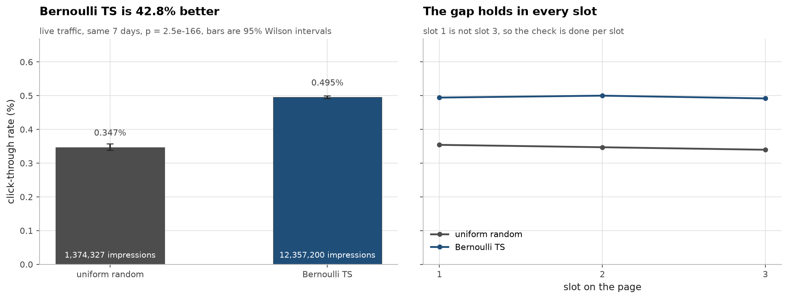
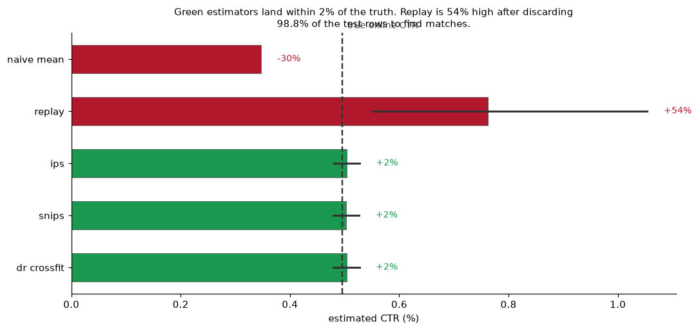
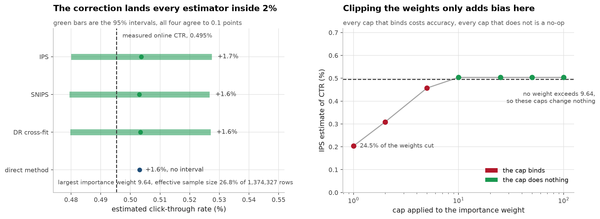
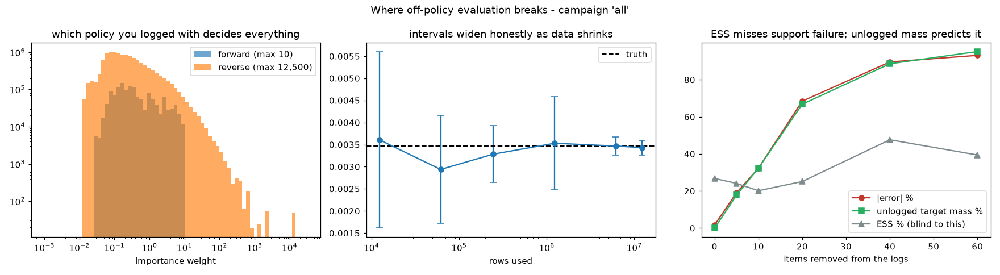
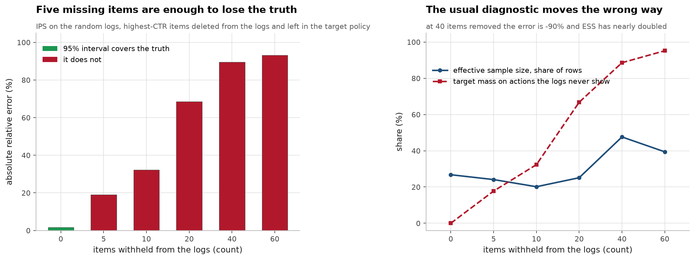
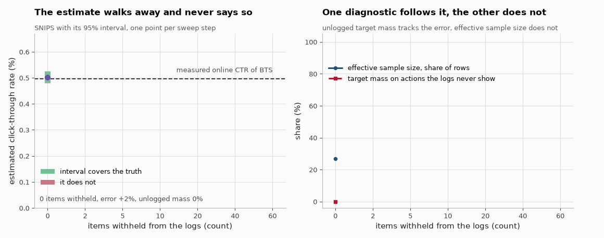
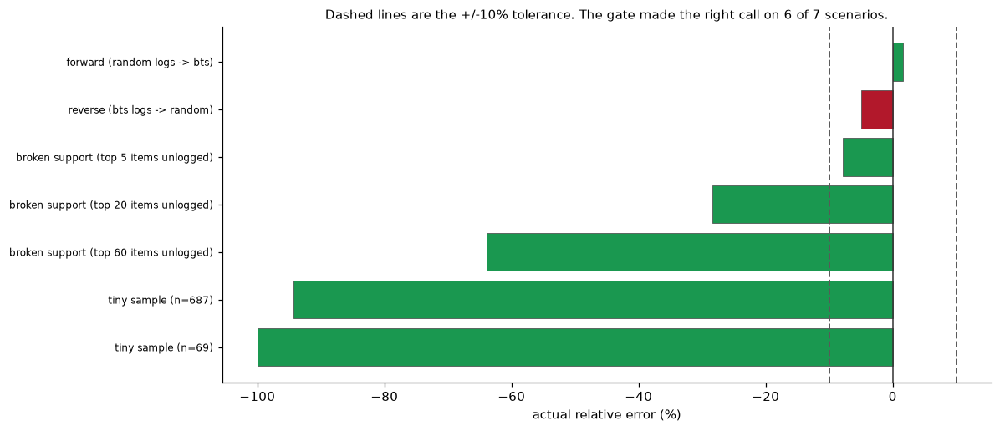

# Offline metrics vs online lift, checking recommender evaluation against a known answer

[](https://doi.org/10.5281/zenodo.23003666)

Offline recommender metrics often decide whether a policy ships, and usually
nobody checks them against anything. The Open Bandit Dataset (ZOZOTOWN) is
different. It logged real production traffic under a uniform-random policy and a
Bernoulli Thompson Sampling policy at the same time, and it recorded the
probability of every action. So we know the true online CTR of both policies. I
wanted to answer one question. Using only the random logs, can you work out how
well BTS does?

Every number below comes out of this repo. I then derived each one a second time
from a rawer layer of the same logs, in C, Rust, Go, R, SQL, Ruby and JavaScript
code that shares nothing with the Python. `verify/` runs both, and CI fails the
build if they disagree. The full write-up is in
[notes/METHODS.md](notes/METHODS.md), and my notes, wrong turns included, are in
[NOTES.md](NOTES.md).

## The known answer

7 days of live traffic, both policies running concurrently over 80 items.

| policy | impressions | clicks | CTR | 95% CI |
|---|---|---|---|---|
| uniform random | 1,374,327 | 4,768 | 0.00347 | [0.00337, 0.00357] |
| Bernoulli TS | 12,357,200 | 61,208 | 0.00495 | [0.00491, 0.00499] |

BTS is +42.77% better than random, p = 2.5e-166. That's the target every
estimator has to hit. I checked four fairness assumptions in the data. One is that
both policies ran over the same 7 days, so BTS can't just have had a better week.
The rest are in [notes/METHODS.md](notes/METHODS.md#1-the-known-answer).



## What the shortcuts get wrong

| estimator | estimate | error vs truth |
|---|---|---|
| quote the logged CTR | 0.00347 | **−30.0%** |
| replay / matched rows | 0.00763 | **+54.0%** |
| direct method, empirical | 0.00475 | −4.1% |
| direct method, logistic | 0.00355 | −28.4% |

Two methods that both sound reasonable disagree by 84 points, and they land on
opposite sides of the truth. Replay's error isn't small-sample noise. It's bias,
since the true value is outside its 95% interval of [0.00551, 0.01054]. The
logistic click model has the decent AUC, 0.5386, but the worse value estimate. So
the supervised metric ranks the two the opposite way from the decision you're
actually making.
[Detail](notes/METHODS.md#2-what-the-naive-offline-evaluation-says).



## What the propensity correction fixes

| estimator | estimate | error vs truth | 95% CI | covers truth |
|---|---|---|---|---|
| IPS | 0.00504 | **+1.7%** | [0.00480, 0.00527] | yes |
| SNIPS | 0.00503 | **+1.6%** | [0.00479, 0.00527] | yes |
| doubly robust (cross-fitted) | 0.00503 | **+1.6%** | [0.00480, 0.00527] | yes |
| direct method (all 7 days) | 0.00503 | **+1.6%** | n/a | n/a |

The errors went from a range of −30% to +54% down to under 2%, and every interval
covers the truth. I expected heavy-tailed weights and there aren't any. Uniform
logging caps the largest weight in 1.37 million rows at 9.64. People usually
suggest clipping, but here it only adds bias. All four corrected estimators agree
to within 0.1 points, so this benchmark can't tell them apart.
[Weights and the clipping sweep](notes/METHODS.md#3-what-the-propensity-correction-fixes).



## Where it breaks

Evaluating from uniform-random logs is the easy direction, and nobody has logs
like that in production. So I ran three stress tests, each still graded against a
known answer. Reversing the direction takes the largest weight from 9.6 to 12,500,
and the effective sample size from 26.8% to 0.16%. Shrinking the data still leaves
the interval coverage correct. Deleting the highest-CTR items from the logs is what
breaks it. ESS doesn't just miss that failure. It moves the wrong way, and
at 40 items removed the estimate is off by −89.6% and ESS has gone up to 47.6%. The thing that
does track the error is the target policy's probability mass on actions the logs
never saw, and it's free to compute.
[Full stress tests](notes/METHODS.md#4-where-it-breaks).







*Each frame deletes the next highest-CTR items from the logs. The estimator and
the target policy stay the same, so the drift away from the measured true CTR line
comes only from losing support.*

## The deliverable is a gate, not a model

`harness.audit()` only returns a value when the diagnostics pass. Otherwise it
returns `value=None` and the reasons. I did it this way because nobody can paste a
withheld number into a slide, but they can paste a wrong one. I didn't fit the
thresholds. Graded on interval coverage against the known answers, it gets
6 of 7 right at a 10% tolerance.

| scenario | gate | true error | unlogged mass | ESS | correct |
|---|---|---|---|---|---|
| forward (random → BTS) | ok | +1.6% | 0.0% | 367,933 | yes |
| reverse (BTS → random) | ok | −5.0% | 0.0% | 19,910 | **no** |
| top 5 items unlogged | refuse | −7.9% | 17.7% | 310,817 | yes |
| top 20 items unlogged | refuse | −28.3% | 66.8% | 259,170 | yes |
| top 60 items unlogged | refuse | −63.9% | 95.2% | 135,418 | yes |
| n = 687 | refuse | −94.3% | 4.6% | 196 | yes |
| n = 69 | refuse | −100.0% | 74.1% | 24 | yes |

The thresholds, the API and the two things I got wrong while building it are in
[notes/METHODS.md](notes/METHODS.md#5-the-deliverable-is-a-gate-not-a-model).



## Limitations

The gate's one false accept is still an open problem. In the reverse direction
its interval [0.003131, 0.003464] misses the truth by 1.0 half-widths. That
happens because at max weight 12,500 and ESS 0.16% the normal approximation behind
the standard error is slightly anti-conservative. I could tighten a threshold to
catch it, but then I'd be choosing the threshold by looking at the answer. So I've
left it documented. The proper fix would be a bootstrap or empirical-Bernstein
interval. I did measure what tightening would cost. An ESS floor above 19,910 gets
all seven scenarios right, but it loses one or two correct decisions on the wider
grid of scenarios the gate was never scored on.
Everything here also comes from one 7-day window at one retailer. Like the Open
Bandit benchmark, I model the BTS target policy as context-free but
position-dependent.

## Demo

```bash
uv run streamlit run app.py
# or
docker build -t roo . && docker run -p 7860:7860 roo
```

The gate's decision depends on three numbers, so you can move the thresholds in
the app. When you do, the real gate logic re-runs on the full-data numbers above. I
show the true values on purpose, so you can see the estimator be confidently wrong
while the gate holds it back.

## Reproducing

```bash
uv sync
curl -L -o data/obd.zip https://research.zozo.com/data_release/open_bandit_dataset.zip
unzip -q data/obd.zip -d data/          # 400 MB download, 11 GB unpacked

uv run python src/roo/prepare.py --campaigns all  # 7 GB csv -> 78 MB parquet
uv run python src/roo/eda.py all                  # the known answer
uv run python src/roo/baseline.py all             # the naive estimators
uv run python src/roo/ope.py all                  # IPS / SNIPS / DR
uv run python src/roo/stress.py all               # where the correction fails
uv run python src/roo/harness.py all              # the gate, scored against truth
uv run python src/roo/harness.py all --export-grid # data for the demo app

# self-checks: no dataset needed, so CI does not need the 11 GB download
for m in baseline ope stress harness; do uv run python src/roo/$m.py --self-check; done
```

The raw logs and the derived Parquet are gitignored. The stack and roadmap are in
[notes/METHODS.md](notes/METHODS.md#9-stack).

## Layout

```
src/roo/    prepare, eda, baseline, ope, stress, harness, one per stage
src/rsoo/   figure generation
reports/    json results and the figures above
app_data/   precomputed diagnostics for app.py, the Streamlit demo
notes/      METHODS.md, the full write-up
verify/     seven languages re-deriving the tables above from the raw logs
```

## Data and licence

[Open Bandit Dataset](https://research.zozo.com/data.html) (ZOZO Research),
released for research use.

My code is MIT, see [LICENSE](LICENSE).

## References

These are the three papers I took the estimators and the framing from.

- **Dudík, Langford, Li. Doubly Robust Policy Evaluation and Learning. ICML 2011.** [arXiv:1103.4601](https://arxiv.org/abs/1103.4601) the doubly robust estimator.
- **Swaminathan, Joachims. The Self-Normalized Estimator for Counterfactual Learning. NeurIPS 2015.** SNIPS, the self normalised variant.
- **Gilotte, Calauzènes, Nedelec, Abraham, Dollé. Offline A/B testing for Recommender Systems. WSDM 2018.** [arXiv:1801.07030](https://arxiv.org/abs/1801.07030) the offline versus online comparison this repo is built around.
